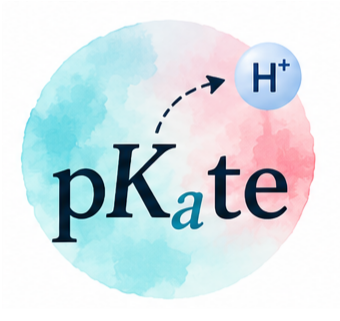
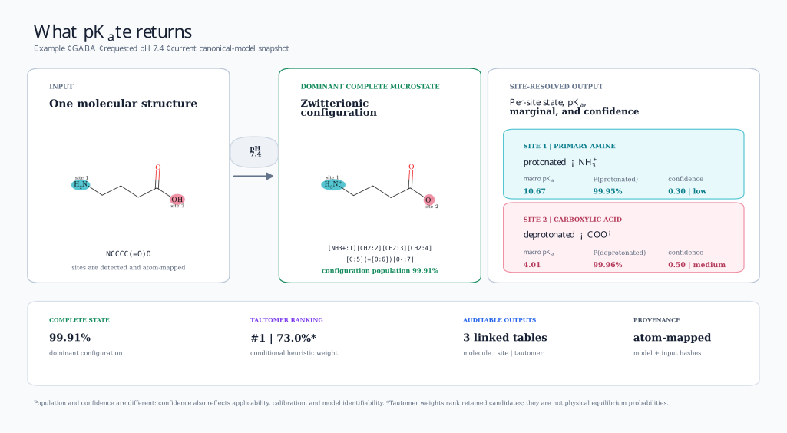
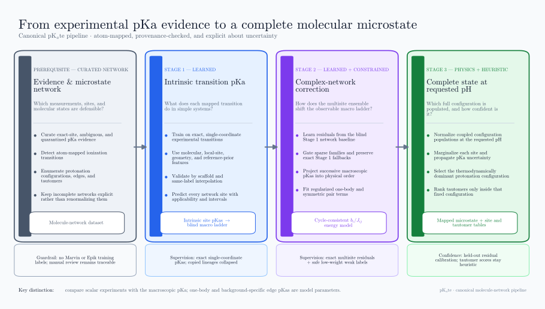

<h1 align="center">
  
</h1>

[](https://github.com/k-zator/pKate/actions/workflows/tests.yml?query=branch%3Amain)
[](https://app.codecov.io/github/k-zator/pKate)
[](CHANGELOG.md)
[](environment.yml)
[](LICENSE)

An atom-mapped, provenance-aware pipeline for predicting molecular
protonation microstates, site protonation probabilities, and pKa behavior in
multisite molecules.

**Full documentation:** Read the
[scientific pipeline guide](scripts/CANONICAL_PIPELINE_GUIDE.md) for the
complete Stage 1–3 methodology, assumptions, schemas, provenance rules,
training and inference workflows, output interpretation, and limitations.

## One prediction, at a glance



This is a real snapshot from the current Stage 3 output for GABA at pH 7.4.
It illustrates that pKₐte returns a complete atom-mapped molecular microstate,
not just one scalar pKₐ: each detected site has a state call, macroscopic pKₐ,
coupled marginal, uncertainty-aware confidence, and provenance. Population and
confidence are deliberately shown separately. Values can change when the
models are retrained; regenerate the figure with
`python scripts/render_prediction_example.py`.

## What the project does

pKₐte separates three questions that are often accidentally mixed:

1. **Stage 1 — intrinsic transition pKa:** learn transferable behavior for a
   mapped acid/base transition from experimentally anchored,
   single-coordinate systems.
2. **Stage 2 — complex-network correction:** correct the blind macroscopic pKa
   ladder in multisite molecules and express it as one cycle-consistent
   pairwise free-energy model.
3. **Stage 3 — complete state at a requested pH:** evaluate that energy model
   over the enumerated molecular network, calculate configuration populations
   and site marginals, and rank tautomers inside the dominant protonation
   configuration.

The primary result is not merely a charged SMILES. It is an auditable complete
microstate prediction accompanied by per-site probabilities, uncertainty,
applicability, free-energy reconstruction diagnostics, and tautomer-ranking
provenance.



The detailed scientific description is in
[`scripts/CANONICAL_PIPELINE_GUIDE.md`](scripts/CANONICAL_PIPELINE_GUIDE.md).
The concise file-to-stage map is
[`scripts/PIPELINE_STAGE_MAP.md`](scripts/PIPELINE_STAGE_MAP.md).

## Scientific scope and guardrails

- Canonical model training is experimental-only: Marvin and Epik values are
  rejected as training labels.
- Exact-site evidence is kept separate from ambiguous molecule-level pKas.
- Incomplete microstate networks are reported as unavailable rather than
  normalized over a partial state space.
- A Stage 2 pair coupling is a regularized closure of a predicted macroscopic
  ladder, not automatically a uniquely measured interaction energy.
- Scalar experimental pKas are compared with macroscopic predictions. Stage 3
  one-body and background-specific edge pKas have different meanings.
- Tautomer scores are deterministic ranking heuristics and are never allowed
  to overturn the thermodynamically selected protonation configuration.

## Repository layout

```text
.
├── .github/workflows/tests.yml       # clean-clone unit tests and coverage
├── data/
│   ├── TRAINING_DATA_MANIFEST.csv    # sources, revisions, mappings, hashes
│   ├── curation/                     # review overlays and reference priors
│   ├── raw/                          # external inputs; not committed
│   └── processed/                    # generated data/models; not committed
├── docs/                             # GitHub-ready pipeline figure
├── scripts/
│   ├── CANONICAL_PIPELINE_GUIDE.md   # detailed scientific documentation
│   ├── stage1_*.py                   # intrinsic pKa data, training, inference
│   ├── stage2_*.py                   # network correction and energy closure
│   ├── stage3_*.py                   # populations, calibration, tautomers
│   └── run_canonical_protonation_pipeline.py
├── pkate.py                           # public unseen-molecule API and CLI
├── sdf_fixer/                        # interactive/raw-structure repair tools
├── tests/                            # unit and data-dependent validation
├── environment.yml                   # recommended conda environment
├── LICENSE                           # PolyForm Noncommercial 1.0.0 terms
├── models/                           # deployment-artifact manifest and instructions
└── requirements-dev.txt              # pip/CI alternative
```

See [`data/README.md`](data/README.md) before adding datasets or trained model
artifacts to a clone.

## Training data and provenance

The training SDFs are **not included in a Git clone**. The canonical build
currently reads five locally protonation-corrected snapshots from `data/raw/`:

| Required local file | Records | Upstream origin |
|---|---:|---|
| `experimental_training_datasets.sdf` | 5,994 | ChEMBL25 + DataWarrior prepared collection |
| `AvLiLuMoVe_testdata.sdf` | 123 | AvLiLuMoVe literature collection |
| `novartis_testdata.sdf` | 280 | Novartis external collection |
| `FIXED_chembl26.sdf` | 8,503 | ChEMBL26 experimental pKₐ collection |
| `literature_compilation.sdf` | 1,765 | Multipublication experimental compilation |

The first three were acquired together from the
[pKₐsolver data repository](https://github.com/wiederm/pkasolver-data), in its
`Baltruschat/` directory. They ultimately trace to Czodrowski Lab's
[Machine learning meets pKₐ](https://github.com/czodrowskilab/Machine-learning-meets-pKa)
collection, archived as
[Zenodo DOI 10.5281/zenodo.7884512](https://doi.org/10.5281/zenodo.7884512).
The last two came from the
[Multiprotic-pKₐ-Processing](https://github.com/czodrowskilab/Multiprotic-pKa-Processing)
repository. The original publication is
[Baltruschat and Czodrowski, 2020](https://doi.org/10.12688/f1000research.22090.2).

These links provide the **upstream originals**, not the exact pKₐte inputs:
pKₐte's local SDFs contain subsequent protonation-form repairs. Exact source
revisions, upstream-to-local filename mappings, record counts, SHA-256 hashes,
and licensing notes are recorded in
[`data/TRAINING_DATA_MANIFEST.csv`](data/TRAINING_DATA_MANIFEST.csv) and
explained in [`data/README.md`](data/README.md). Until the corrected snapshots
are deposited as a versioned release asset, a clean clone can inspect and run
tests but cannot reproduce a full training run from the upstream downloads
alone.

Marvin and Epik numerical predictions are not accepted as canonical training
labels. Large Epik-derived files present in the development workspace are not
part of the five-file experimental training set.

## Installation

### Conda or Mamba — recommended

RDKit is a compiled dependency, so the conda-forge environment is the most
reproducible setup:

```bash
git clone https://github.com/k-zator/pKate.git
cd pKate

mamba env create -f environment.yml
mamba activate pkate
```

`conda env create -f environment.yml` works when Mamba is unavailable.

### Python virtual environment

PyPI wheels are also supported on platforms for which RDKit publishes them:

```bash
python3.11 -m venv .venv
source .venv/bin/activate
python -m pip install --upgrade pip
python -m pip install -r requirements-dev.txt
```

Confirm the environment:

```bash
python -c "from rdkit import Chem; print(Chem.MolFromSmiles('CC(=O)O').GetNumAtoms())"
python scripts/run_unit_tests.py
```

All commands below are intended to be run from the repository root.

## Predicting a new molecule

The public interface accepts one previously unseen SMILES and a requested pH.
It detects and atom-maps ionizable sites, enumerates the molecule's protonation
network, and runs the fitted Stage 1 → Stage 2 → Stage 3 path without consuming
an experimental pKₐ for the query.

From the command line:

```bash
python -m pkate "NCCCC(=O)O" --ph 7.4
```

The command prints JSON containing the dominant complete microstate,
configuration probability, formal charge, site-specific macroscopic pKₐs,
protonated-state marginals and intervals, confidence tiers, ranked tautomers,
warnings, and model hashes. For complex predictions it also returns explicit
protein-residue site rows and `dominant_protein_site_forms`. Preserve the
detailed intermediate artifacts when
needed:

```bash
python -m pkate "NCCCC(=O)O" --ph 7.4 --output-dir prediction_gaba
```

The same operation is available as a Python function:

```python
from pkate import predict

result = predict("NCCCC(=O)O", ph=7.4)

print(result.dominant_microstate_smiles)
for site in result.site_predictions:
    print(
        site["site_label"],
        site["predicted_macroscopic_pka"],
        site["protonated_probability"],
        site["confidence_tier"],
    )
```

### Optional protein-environment correction

For a ligand with a posed structure in a protein binding site, pKₐte can apply
an optional environment layer between Stage 2 and Stage 3. The aqueous
prediction remains intact in the output. The layer corrects ligand one-body
terms and, by default, adds nearby Asp/Glu/His/Lys/Cys/Tyr side chains as
explicit binary protonation coordinates. Stage 3 then jointly populates the
ligand and tractable local protein network from one partition function.

```bash
python -m pkate "CNCC(=O)O" --ph 7.4 \
  --protein complex.cif \
  --ligand posed_ligand.sdf \
  --ligand-chain L --ligand-resname LIG --ligand-resid 401 \
  --output-dir prediction_in_protein
```

The ligand file must represent the same heavy-atom graph as the input SMILES
and use the protein structure's coordinate frame. Both `--protein` and
`--ligand` are required; omitting both preserves the original aqueous path.
The API exposes the same arguments as `protein_structure=` and
`ligand_structure=`.

Residues within 8 Å of a modeled ligand site are considered in nearest-first
order. At most six are included, and the crossed network may contain at most
4096 configurations; these limits are configurable with
`--joint-protein-radius`, `--max-joint-protein-sites`, and
`--max-joint-nodes`. Use `--no-joint-protein-sites` to retain only the earlier
static environment-shift behavior. The JSON site list identifies ligand and
protein components separately; `dominant_protein_site_forms` reports every
included residue in the dominant joint configuration. Arginine and chain
termini are not explicit coordinates in this release because the fitted
PKAD-R representation does not calibrate them.

This is a cautious first-generation model, not a general protein
electrostatics calculation. Protein-residue one-body shifts are calibrated on
643 strict, structure-mapped PKAD-R protein side-chain pKas plus 990
de-overlapped PKAD-3 rows at a capped effective weight of 160.75, with
homology-grouped validation (OOF MAE 0.870 pKₐ unit versus 0.987 for applying
no shift). Ninety-five distinct-structure mutant/state perturbation pairs are
audited but not deployed because they worsen paired-delta OOF error. Its calibration ledger covers
all 648 strict structure-mapped sites: 643 have OOF predictions and five with
missing terminal site atoms are retained as unavailable. Group-bootstrap
calibration supports a full correction for carboxyl analogues, half-scaled
provisional corrections for imidazole and thiol, and currently withholds amine
and phenol corrections because they did not beat both control baselines.
Other unsupported ligand chemistries likewise remain at their aqueous
prediction. Dynamic ligand–protein and protein–protein pair terms are centered,
distance-screened Coulomb approximations; PKAD-R does not identify those
couplings, so they are labelled heuristic and reduce Stage 3 confidence. See the
[data audit](docs/PROTEIN_ENVIRONMENT_DATA_AUDIT.md) for the evidence boundary
and the [calibration/benchmark report](docs/PROTEIN_ENVIRONMENT_BENCHMARK.md)
for the leakage-controlled PKAD-2 result and experimental binding-shift panel,
and the [pipeline guide](scripts/CANONICAL_PIPELINE_GUIDE.md#78-optional-protein-environment-correction)
for descriptor and free-energy details.

The optional model is generated locally because redistribution rights for the
PKAD-R label table remain unclear:

```bash
python scripts/train_protein_environment_model.py
```

This also prepares and tests the de-overlapped PKAD-3 supplement by default.
Its 990 coordinate-resolved candidates are admitted only if both pooled and
equal-homology-group MAE improve on held-out canonical PKAD-R sites. The
current candidate improves pooled MAE from 0.9023 to 0.8701 and group-balanced
MAE from 1.1516 to 1.1137, so all 990 rows are deployed at a capped effective
weight of 160.75.

The trainer writes `calibration.json` and
`strict_648_site_calibration_cohort.csv` beside the local model. It also writes
`perturbation_pairs_and_oof.csv` and a machine-readable exclusion ledger. The
mutant/state rows enter only when they improve held-out paired shifts without
degrading the canonical cohort; repeat measurements quantify noise rather than
becoming duplicate training rows.

Run the independent-data audit and portability benchmark with:

```bash
python scripts/acquire_binding_shift_structures.py
python scripts/benchmark_protein_environment.py
```

The de-overlapped PKAD-2 portability cohort improves MAE from 0.676 for the
aqueous residue-reference baseline to 0.496 pKₐ units for the deployed gated
model (72 mapped unique measurements). This is not a fully independent headline
test: only one row survives a conservative 0.80 near-duplicate proxy because PKAD-R is a
curated successor to PKAD-2. The runner makes that limitation machine-readable
and never accepts computational-teacher labels as evaluation truth.

The separate 13-case binding-induced shift challenge is deliberately harsher:
all cases map, but the frozen model obtains MAE 2.941 pKₐ units on seven exact
shifts and satisfies only three of six one-sided bounds. This negative result
shows that the current static local environment descriptors are not yet a
reliable predictor of binding-induced pKₐ changes; the challenge labels remain
evaluation-only and are not used to improve the reported score.

Direct experimental bound-ligand calibration now has an explicit, fail-closed
path rather than a hard-coded zero. The literature registry contains 15
free/bound ligand pKₐ cases; seven have exact ligand and protein identity,
exact complex coordinates, a mapped atom, and an exact point label. They are
two DHFR heteroaromatic ligands (`3DFR` and `2HM9`) and five human
GST–glutathione thiol transitions (`1PKW`, `1TDI`, `1XW6`, `1XW5`, and
`5GSS`). Homologous GSTs share groups, so the strict set covers four protein
groups and two chemistries. The minimum gate of 12 rows, six protein groups,
and three chemistries therefore remains closed. The fitted bundle records
seven candidates and **zero deployed direct-ligand rows**; ligand corrections
still use uncertainty-shrunk protein-residue analogue transfer.

The CC BY 4.0 PLBD snapshot is also integrated as proton-linkage consistency
evidence. It yields 225 experimental compound-pKₐ rows, 50 protein-pKₐ rows,
and 1,649 joined intrinsic-binding constraints. Those intrinsic parameters are
already corrected for linked protonation and are not measurements of a
site-resolved bound-ligand pKₐ, so PLBD contributes zero direct calibration
rows and is never presented as such.

For small-molecule expansion, the
[pKahub transition-assignment survey](docs/PKAHUB_TRANSITION_ASSIGNMENT_SURVEY.md)
explains why pKahub's Epik-derived charge transitions cannot be used as labels.
The integration discards those assignments and uses only experimental pKa
values. The current gate admits 4,801 uniquely assigned single-transition rows
to Stage 1 at a capped effective weight of 1,120.6; on the locked canonical
scaffold folds, the combined supplemental fit improves MAE from 0.6567 to
0.6339. Stage 2 evaluates 14,247 complete pKahub macro-site rows and deploys
them at an effective weight of 186.35 because exact-site scaffold MAE improves
slightly from 0.9318 to 0.9307. Another 8,467 weak rows remain blocked by
incomplete candidate state spaces. Epik assignment fields remain excluded at
every stage.

CASP16 is integrated separately. The checksum-locked release contains 72
numeric experimental pKa values across 63 ligands; every ADMET Predictor field
is ignored. Acid/base class uniquely resolves 32 Stage 1 transitions; after
the joint supplement cap they contribute an effective weight of 5.40 alongside
2,252 canonical rows. Plain indole is now correctly treated as an extreme-range
context rather than an unresolved basic site, so all three multisite CASP16
molecules have complete four-state networks and all five macro values reach
the Stage 2 gate. That gate rejects them because exact-site scaffold MAE would
worsen from 0.9307 to 0.9444. The 18 associated RCSB complexes remain
checksum-recorded reference coordinates: CASP16 does not establish that these
pKa values were measured in the bound state.

The 12-transition 2026 metalloprotein panel is likewise not training data. It
is a locked specialist benchmark with exact, approximate, and upper-bound
targets scored separately by
[`benchmark_metalloprotein_pka.py`](scripts/benchmark_metalloprotein_pka.py).
The acquired author SI is CC BY-NC 4.0 and remains ignored by Git. Scoring the
paper's published external QM predictions gives exact-label MAE 1.525 over
eight cases, approximate-label MAE 4.20 over three, and violates the one upper
bound by 1.60 pKₐ units. These are published-method results, not pKate
predictions and not training labels.
See the [protein-environment benchmark policy](docs/PROTEIN_ENVIRONMENT_BENCHMARK.md).

The fitted experimental-only Stage 1/2 models and their held-out calibration
tables must be present under `data/processed/ml_models_experimental_only/`.
They are intentionally not committed to Git. A 3.3 MiB deployment bundle
containing the exact six required artifacts has been assembled locally. The
remote upload is pending source-license review for the canonical source data,
pKahub source-specific terms, and the accepted CASP16 Stage 1 supplement. See
[`models/README.md`](models/README.md) and the committed
[`model artifact manifest`](models/MODEL_ARTIFACT_MANIFEST.json) for its
contents, checksums, and installation layout.
Calls outside the supported chemistry are retained with explicit applicability
and confidence warnings; a molecule with no supported ionizable sites is
returned unchanged rather than assigned a fabricated pKₐ.

## Running the canonical pipeline

### Existing fitted models and prepared network

If the Stage 1-scored network and fitted Stage 2 model have been restored under
their documented paths, run Stage 2 and Stage 3 together with:

```bash
python scripts/run_canonical_protonation_pipeline.py --ph 7.4
```

The runner verifies the Stage 1/2 provenance, applies the network correction,
evaluates complete-state populations at the requested pH, writes flat site and
tautomer tables, and records an end-to-end hash manifest.

### Full rebuild

After placing the licensed raw data under `data/raw/`:

```bash
python scripts/build_release_microstate_dataset.py

python scripts/build_molecule_microstate_network_dataset.py \
  --allow-stage1-detector-mismatch

python scripts/stage1_train_intrinsic_pka.py \
  --network-dataset data/processed/pka_molecule_microstate_network_dataset.csv \
  --out-dir data/processed/ml_models_experimental_only/stage1_intrinsic

python scripts/build_molecule_microstate_network_dataset.py
python scripts/stage2_train_network_context.py
python scripts/run_canonical_protonation_pipeline.py --ph 7.4
```

The two network builds around Stage 1 retraining are intentional: the first
refreshes topology and labels, while the second embeds predictions from the new
Stage 1 model.

## Principal outputs

| Artifact | Meaning |
|---|---|
| `pka_molecule_microstate_network_dataset.csv` | Atom-mapped sites, nodes, edges, experimental evidence, and blind Stage 1 baseline |
| `pka_molecule_microstate_network_stage2_predictions.csv` | Corrected macro ladder and cycle-consistent one-body/pair model |
| `pka_molecule_microstate_network_stage3_predictions.csv` | One row per molecule with populated network and selected complete state |
| `stage3_site_predictions.csv` | One row per site with macro/edge pKas, marginals, intervals, and confidence |
| `stage3_ranked_tautomers.csv` | Auditable configuration-level tautomer ranking |
| `canonical_pipeline_run_manifest.json` | Exact input, model, intermediate, and output hashes |

All generated outputs live under `data/processed/` and are excluded from Git by
default.

## Tests and coverage

The fast clean-clone suite exercises functional-group detection, microstate
enumeration, evidence policy, Stage 1 data/inference, Stage 2 thermodynamics,
Stage 3 populations/calibration/tautomers, visualization helpers, the
canonical runner, and the unseen-molecule API:

```bash
python scripts/run_unit_tests.py
```

Generate terminal, XML, and browsable HTML coverage reports with:

```bash
python scripts/run_unit_tests.py --coverage --html
xdg-open htmlcov/index.html
```

The local 0.2.0 release-candidate validation on 8 November 2026 passes all
1,246 clean-clone tests. Coverage is 89.06% of lines and 76.68% of branches,
for 86.10% combined coverage. The fitted estimator archive is serialized with
scikit-learn 1.8.0, which is pinned in both supported environment definitions;
arbitrary scikit-learn versions are not a supported model-loading runtime.

Data-heavy model degradation and retraining checks remain available separately:

```bash
pytest -m slow
```

Those tests require the local raw datasets and trained artifacts and are not
part of the clean-clone CI gate.

## Documentation and review tools

- [Detailed pipeline guide](scripts/CANONICAL_PIPELINE_GUIDE.md)
- [Authoritative stage-to-file map](scripts/PIPELINE_STAGE_MAP.md)
- [Molecule-network dataset schema](scripts/README_molecule_microstate_network_dataset.md)
- [Protein-environment calibration and benchmark](docs/PROTEIN_ENVIRONMENT_BENCHMARK.md)
- [ML commands and legacy-pipeline notes](README_ml.md)

Regenerate the repository figures with:

```bash
python scripts/render_pipeline_overview.py
python scripts/render_prediction_example.py
```

Generate the canonical Stage 3 review galleries with:

```bash
python scripts/visualize_canonical_stage3_failures.py
```

The review queues distinguish held-out pKa errors from uncertainty,
applicability, assignment, coupling, and network-completeness diagnostics.

## Current limitations

- Protein-environment portability improves on related PKAD-2 data, but only one
  near-duplicate-disjoint residue survives; genuinely external performance is
  therefore still unestablished.
- Sparse exact transition labels can require disclosed reference-prior
  fallbacks.
- Macroscopic scalar pKas do not uniquely identify all microscopic pair terms.
- Tautomer ranking is rule-based rather than trained on solution-phase tautomer
  populations.
- Raw-data redistribution and licensing must be handled per source; the Git
  repository tracks curation logic but not the multi-gigabyte source corpus.

Please cite or redistribute the underlying experimental datasets according to
their original licenses and provenance records.

## License

Copyright © 2026 Katarzyna J. Zator.

Except for third-party datasets and artifacts that carry their own terms, this
repository is available under the
[PolyForm Noncommercial License 1.0.0](LICENSE). It permits use, modification,
and redistribution for noncommercial purposes under its stated conditions; no
commercial-use license is granted by these terms.
